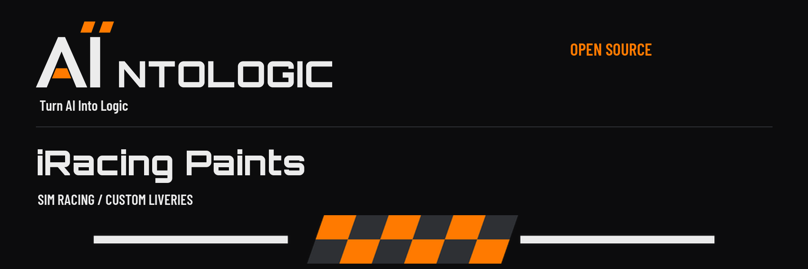
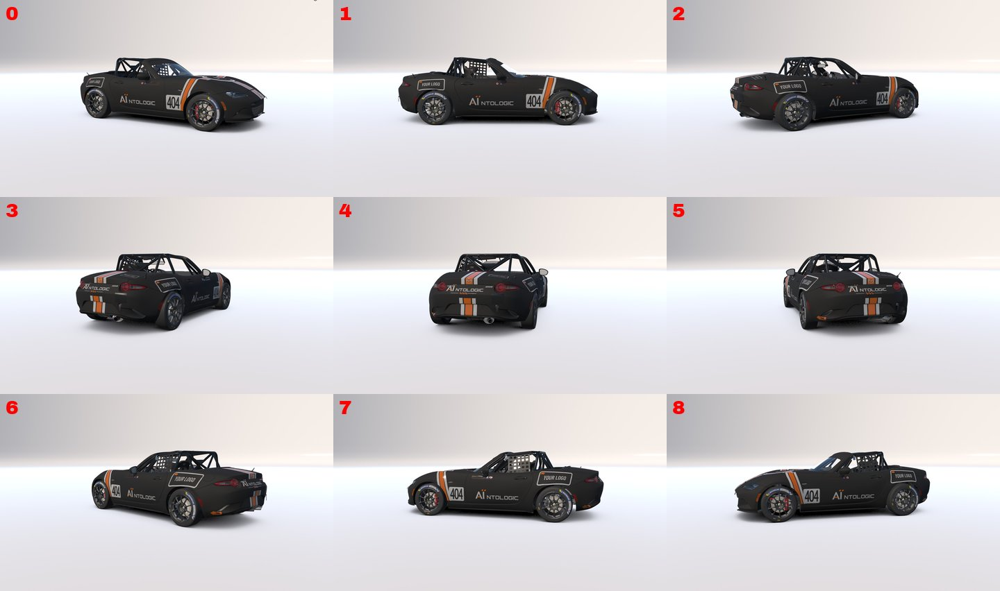
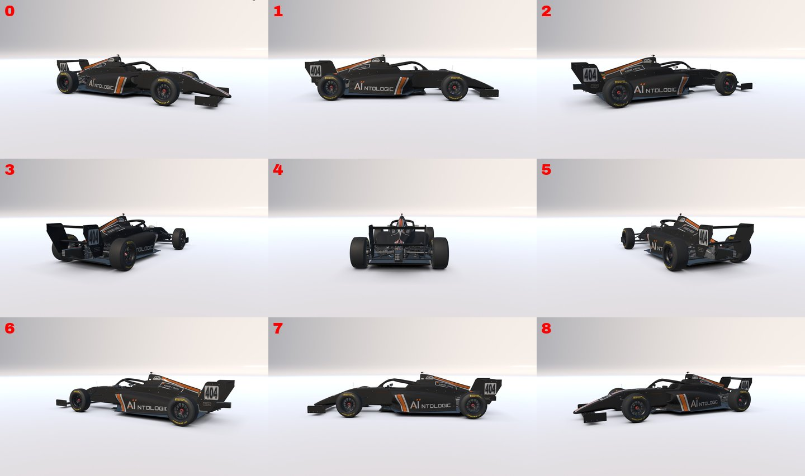
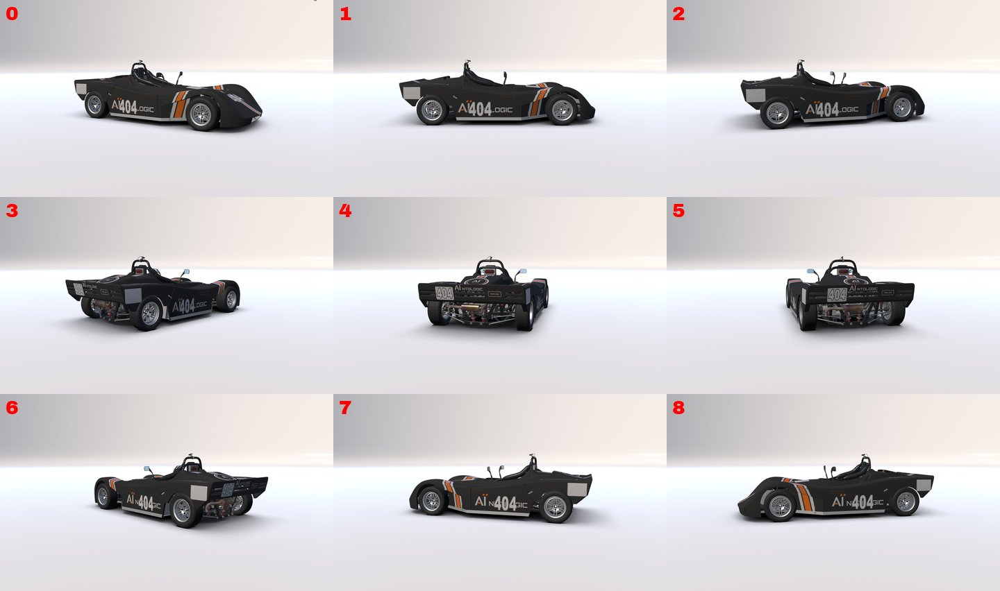
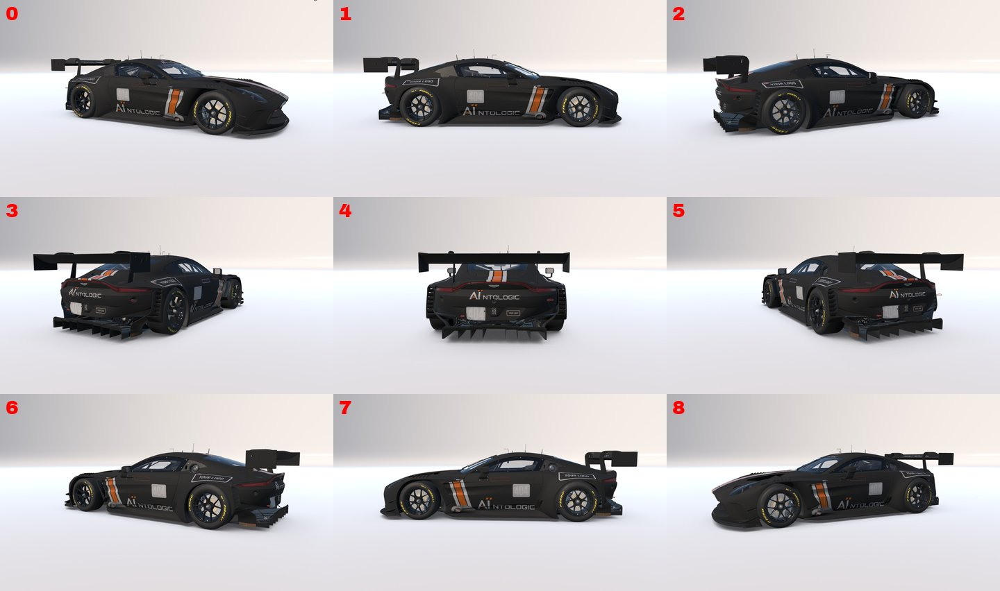

# iRacing Paints

**Paint any iRacing car with help from an AI assistant.**

You describe the car you want, the way you would brief a painter. The AI asks a
few questions, shows you a preview, and builds the paint once you approve it.
The tools in this project do the hard part: they measure how iRacing's flat
paint template wraps around the real car, so stripes, names and logos land in
the right place, the right way up, on both sides.

Because the tools measure each car, they aren't limited to a fixed list. They
work on any car in iRacing, including cars iRacing hasn't released yet.

If you can describe a car to a friend, you can do this. You don't need to draw
or write code. You do need to install a few free programs yourself; each one is
explained below. Nothing in this project installs itself.

> **Where it stands today.** Ten cars are already measured and painted. They
> were chosen to cover the main kinds of car: formula cars, a prototype, GT
> cars and road-based cup cars. Any other car takes one extra step: the AI
> measures it first. On any car you can put your name, two logos of your own and
> your iRacing customer ID on an example design. Picking your own colors and
> layout isn't in this version yet; it's planned for a later one.

## What and why

Painting an iRacing car by hand means working on a flat, stretched-out map of
the car's body in an image editor, then checking it in the sim, again and
again. A stripe that looks straight on the map can bend over a fender, and your
name can come out backwards on the left door. (That one happens more than
anyone admits.)

This project measures the car instead of guessing. It reads the panel outlines
from iRacing's own paint template for that car, then checks its measurements
with test patterns in iRacing's car viewer. Once a car is measured, a design can
be placed on it accurately and rebuilt exactly the same way every time.

An AI assistant runs those tools for you. You say what you want in plain words,
and it does the measuring and the building.

The black, papaya and white AÏntologic cars in the gallery are examples of what
the tools can do. Nobody has to drive around in our colors.

### What the AI does, and what it doesn't

- **It does:** ask what you want, explain what is possible, measure the car if
  it's new to the project, run the build tools in this folder, show you a
  preview, and write the finished files to the `out` folder.
- **It doesn't:** install software, change files outside this folder without
  asking you first, upload anything, add logos you don't own, or put flames on
  your hood because it was feeling creative.
- **You stay in charge.** Nothing is final until you approve the preview. AI
  assistants can make mistakes, so check the preview before you race.

The full set of instructions the AI follows is in [`AGENTS.md`](AGENTS.md). It
is written in plain language, so you can read exactly what the AI is told.

## What "done" looks like

- One paint file, `car_<your customer ID>.tga`, in iRacing's paint folder for
  that car. An optional second file, `car_spec_<your customer ID>.tga`, adds the
  satin and gloss finish.
- The car shows your paint in iRacing's car viewer and on track.
- By default only you see it. Other drivers see it if you share it through a
  paint service such as Trading Paints (a step-by-step guide is planned).

## What you need

Everything here is free. Install it yourself, in this order.

### 1. Python

**What it is:** a widely used programming language. The tools in this project
are written in it, so your computer needs Python to run them.

**Get it from:** [python.org/downloads](https://www.python.org/downloads/).
On Windows, tick **"Add python.exe to PATH"** on the first screen of the
installer.

### 2. Four Python add-ons

Python add-ons come from the [Python Package Index](https://pypi.org), Python's official public
library of add-ons. You install them with `pip`, the installer that comes with
Python. Open a terminal (on Windows: press Start, type **PowerShell**, press
Enter) and type each command, one at a time, in this order:

| order | add-on | what it is | why this project needs it | command |
|---|---|---|---|---|
| 1 | **[numpy](https://numpy.org)** | fast math on large grids of numbers | a picture is a grid of pixels; numpy does the math on them | `python -m pip install "numpy>=1.24"` |
| 2 | **[Pillow](https://python-pillow.org)** | the standard Python library for opening, drawing and saving pictures | draws every stripe, letter and logo, and saves the paint file | `python -m pip install "Pillow>=10.0"` |
| 3 | **[scipy](https://scipy.org)** | scientific tools built on numpy | finds the outline of each body panel when a car is measured | `python -m pip install "scipy>=1.10"` |
| 4 | **[psd-tools](https://github.com/psd-tools/psd-tools)** | reads Photoshop (.psd) files | iRacing's paint templates are Photoshop files; this reads the layer that shows the panel outlines | `python -m pip install "psd-tools>=1.9"` |

Each add-on's name links to its own website, so you can see who makes it and
what it does before you install it.

If `python` isn't recognized, use `py` instead, for example
`py -m pip install "numpy>=1.24"`.

numpy goes first because scipy and psd-tools are built on it. The same four
add-ons are listed in `requirements.txt` for reference. We don't ask you to
install from that file: installing each one by name lets you see exactly what
goes onto your computer.

### 3. For a car the project hasn't measured yet

- **iRacing on a Windows PC**, so the AI can check its measurements in
  iRacing's car viewer.
- **That car's paint template from iRacing.** See
  [`templates/README.md`](templates/README.md). Six of the ten measured cars
  also need their template once, for a short setup step.

### 4. An AI assistant that can work with files on your computer

It needs to read a folder and run commands, such as Claude Code or Codex. A
chat window that can't see your files won't be able to build the paint.

## Three ways to use it

### 1. Paint it with an AI assistant (recommended)

1. Download this project: the green **Code** button at the top of this page,
   then **Download ZIP**. Unzip it somewhere easy to find.
2. Open the unzipped folder in your AI assistant.
3. Tell it what you want, for example: *"Read AGENTS.md. I'd like a paint for
   the Toyota GR86 with my name and my team logo on it."*
4. If the car is new to the project, the AI measures it first and shows you
   check pictures along the way. This takes longer than a car that's already
   measured.
5. Answer its questions, look at the preview, and say when you're happy.
6. It builds the final files into the `out` folder and tells you where to copy
   them. It only copies them into iRacing for you if you say yes.
7. Open the car in iRacing's car viewer. A new paint shows up when the viewer is
   opened fresh, so copy the paint first, then open the car. If you don't own
   the car, you can open it from the car's page in iRacing's Shop.

### 2. Use a ready-made paint (no AI, nothing to install)

Each measured car comes with a ready-made paint in the example design, with a
blank name strip and a "YOUR LOGO" placeholder in both logo spots.

1. Open `paints/<car>/` and take `car_CUSTOMERID.tga`.
2. Rename it to `car_<your iRacing customer ID>.tga`, for example
   `car_123456.tga`. Your customer ID is shown on your iRacing account page.
3. Copy it into iRacing's paint folder for that car, `Documents\iRacing\paint\<paint folder>\`.
   The paint folder names are in the table below.
4. In iRacing, make sure custom paints are turned on.

Optional: rename `car_spec_CUSTOMERID.tga` the same way, to
`car_spec_<your ID>.tga`, and put it in the same folder for the satin and gloss
finish.

### 3. Run the commands yourself (measured cars)

Build a measured car with your details:

```
python src/team_mx5.py --id 123456 --driver "A. DRIVER" --logo1 mylogo1.png --logo2 mylogo2.png --out out
```

| option | what it does |
|---|---|
| `--id` | your iRacing customer ID; names the file `car_<id>.tga` |
| `--driver` | the name on the cockpit strip (leave it out for a blank strip) |
| `--logo1`, `--logo2` | your own PNG images for the two logo spots (leave them out for the "YOUR LOGO" placeholder) |
| `--out` | the folder the files are written to (default `out`) |
| `--profile` | load saved settings from `profiles/<name>.json` instead of typing them each time |

Swap `team_mx5.py` for the builder of the car you want (see the table below).
Six cars need a one-time setup step first:

```
python tools/first_run.py <car> <your-template.zip>
```

See [`docs/REGENERATING-GEOMETRY.md`](docs/REGENERATING-GEOMETRY.md). Measuring a
new car is a longer, hands-on process; the method is in
[`docs/IRACING-PAINTING-PLAYBOOK.md`](docs/IRACING-PAINTING-PLAYBOOK.md) and
[`docs/PANEL-PROBING.md`](docs/PANEL-PROBING.md).

## Cars measured so far

These are worked examples, picked to cover the main kinds of car. Your car
doesn't need to be on this list. **On track** means the paint has been raced in
iRacing; the others have been checked in iRacing's car viewer.

| car | kind | iRacing paint folder | builder | one-time setup | checked |
|---|---|---|---|---|---|
| Global Mazda MX-5 Cup | road-based cup car | `mx5 mx52016` | `team_mx5.py` | not needed | ✅ on track |
| FIA F4 | formula car | `formulair04` | `team_f4.py` | `f4` | ✅ on track |
| SCCA Spec Racer Ford | sports racer | `specracer` | `team_srf.py` | `srf` | ✅ on track |
| Aston Martin Vantage GT3 EVO | GT3 | `amvantageevogt3` | `team_amv.py` | `amv` | ✅ on track |
| Porsche 911 RSR | GT endurance | `porsche991rsr` | `team_rsr.py` | not needed | car viewer |
| Ferrari 296 Challenge | one-make GT | `ferrari296challenge` | `team_f296c.py` | not needed | car viewer |
| Ray FF1600 | Formula Ford | `raygr22` | `team_ray.py` | `ray` | car viewer |
| Lotus 79 | historic Formula 1 | `lotus79` | `team_l79.py` | not needed | car viewer |
| HPD ARX-01c | prototype | `hpdarx01c` | `team_hpd.py` | `hpd` | car viewer |
| Skip Barber Formula 2000 | formula car | `rt2000` | `team_sbf2000.py` | `sbf2000` | car viewer |

### Gallery

The ready-made paints as they look in iRacing's car viewer: the example design
with a blank name strip and "YOUR LOGO" placeholders. All ten are in
[`docs/gallery/`](docs/gallery/).

**Global Mazda MX-5 Cup**



**FIA F4**



**SCCA Spec Racer Ford**



**Aston Martin Vantage GT3 EVO**



## Versions

Each release of this project has a version number in three parts, like
`0.1.0`.

**While the first number is 0, this project is an early preview.** The tools
and the ten ready-made paints work, but the project isn't finished, and things
may still change from one version to the next. Version 1.0.0 will come when a
newcomer can do all four of these:

- choose their own colors and design;
- paint a car the project hasn't measured yet, by following a plain
  start-to-finish guide;
- get started from a guide written for people who don't code;
- work with the AI like a paint shop: a design brief, a mock-up to approve or
  change, then the finished paint.

Which part of the number goes up tells you what kind of change it is:

- **The last number** is for fixes. If a logo landed in the wrong place and
  that got fixed, `0.1.0` would become `0.1.1`.
- **The middle number** is for something new, such as another measured car or
  a new build option: `0.1.0` would become `0.2.0`. While the first number is
  0, a middle-number release can also change how something already works; the
  change log says when it does.
- **The first number** goes to 1 for version 1.0.0. After that, it only goes up
  for a change you'd have to adjust to, such as a build option being renamed.
  We try hard not to need one.

When one number goes up, the numbers after it go back to 0: after `0.1.3`
comes `0.2.0`.

What changed in each version is in [`CHANGELOG.md`](CHANGELOG.md).

Each car's paint design also has its own revision number, and that is
separate from the project's version. The Aston Martin's design, for example,
is at `v1.1`, as the top of its
[car map](docs/car-maps/aston-martin-vantage-gt3-evo.md) says. A car's design
revision only goes up when that car's paint changes. The project's version goes
up with every release, whether or not any paint changed.

## Getting involved

Questions, problems and ideas are welcome as
[issues](https://github.com/Aintologic/aintologic-iracing-paints/issues). Read
[`CONTRIBUTING.md`](CONTRIBUTING.md) first; it explains how issues are written
here and how changes get in.

## Notice

This is an unofficial, fan-made project. It is **not affiliated with, endorsed
by, or sponsored by iRacing or any car manufacturer**. iRacing's car templates
are iRacing's property and are **not included**; download your own from
iRacing. The paints add no manufacturer logos.

**Use only logos you own or have written permission to use.** iRacing's
[Custom Paint Policy](https://ir-core-sites.iracing.com/members/pdfs/20240926-iRacing_Custom_Paint_Policy_dated_Sept_09_2024.pdf)
does not allow third-party trademarks or logos without the owner's written
permission, and bans political and offensive content and tobacco, alcohol and
drug content. Use is personal and non-commercial.

## License

Free to download is not the same as "do anything you like". In short:

- **Code** (`src/`, `tools/`, `assets/brand/render_banner.py`): GNU
  **AGPL-3.0-or-later**. See [`LICENSE`](LICENSE).
- **Ready-made paints** (`paints/`) and **example logos** (`examples/logos/`):
  **CC BY-NC-SA 4.0**, subject to the trademark terms. See each folder's
  `LICENSE.txt` and [`TRADEMARKS.md`](TRADEMARKS.md).
- **Fonts** (`fonts/`): SIL **Open Font License 1.1**. See
  [`fonts/OFL.txt`](fonts/OFL.txt).
- **Names and logos**: AÏntologic, Freak Farm Racing and Cats Don't Suck are
  **not** covered by any of the above. See [`TRADEMARKS.md`](TRADEMARKS.md).

## For the AI agent

Read [`AGENTS.md`](AGENTS.md) before doing anything else. The person you are
working with is your client and you are their painter: ask before you build,
measure before you place anything, show a preview first, and keep their files
safe. Method: [`docs/IRACING-PAINTING-PLAYBOOK.md`](docs/IRACING-PAINTING-PLAYBOOK.md)
and [`docs/PANEL-PROBING.md`](docs/PANEL-PROBING.md); per-car panel maps:
[`docs/car-maps/`](docs/car-maps/).
