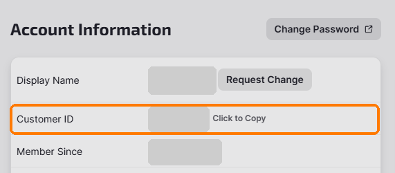

# Getting started

## What and why

This guide is for anyone who has never written code. There are three ways to
use this project, and you can start with the simplest and move on later.

| | you need | you get |
|---|---|---|
| **Path 1. Just the paints** | iRacing on a Windows PC. Nothing to install. | a ready-made paint in the example design, with a blank name strip and "YOUR LOGO" in both logo spots |
| **Path 2. Personalize with a command** | Python and four free add-ons, which you install yourself | the example design with your name and your own two logos |
| **Path 3. Work with an AI assistant** | the same as path 2, plus an AI assistant that can work with files on your computer | the same, plus help with a car the project hasn't measured yet |

We never install anything for you. Where something is needed, this guide says
what it is and where to get it, and you decide.

### Which computers work

- **Building a paint** (paths 2 and 3) works on any computer that runs Python:
  Windows, Mac or Linux.
- **Seeing the car in iRacing needs a Windows PC**, because iRacing only runs
  on Windows. If you build on a Mac or a Linux computer, copy the finished
  files to the Windows PC that runs iRacing.
- **Measuring a car the project hasn't measured yet** is checked in iRacing's
  car viewer, so it needs that Windows PC too.

## What "done" looks like

- Your paint file is in iRacing's paint folder for your car, named with your
  iRacing customer ID: `car_<your customer ID>.tga`.
- You open the car in iRacing's car viewer and your paint is on it.
- Nothing was installed that you didn't install yourself.

## Two things every path needs

### Your iRacing customer ID

iRacing only loads a paint whose file name carries your customer ID, so you'll
need it on every path. To find it in the iRacing app:

1. Click your picture in the top-right corner, then **Account**.
2. On the **My Account** page, look in the **Account Information** box for the
   **Customer ID** row.



The customer ID is a number with a `#` in front of it. Leave the `#` out of
file names: if the page shows `#123456`, your paint is `car_123456.tga`.

You can reach the same page from **Settings** (the gear at the bottom left of
the app), then **My Account**.

This project only uses your customer ID to name your files. It never appears
on the car, and you never need to post it anywhere, including on GitHub.

### Your iRacing paint folder

iRacing keeps its settings, replays and paints in an `iRacing` folder inside
your Documents folder. Paints go one folder deeper, in a folder for each car:

```
Documents\iRacing\paint\<paint folder for the car>\
```

- Each car's paint folder has a short name iRacing chose, such as `formulair04`
  for the FIA F4. The names for the measured cars are in the README's
  [table](../README.md#cars-measured-so-far), and in `INSTALL.txt` inside the
  ready-made paints download.
- Use the name exactly as shown. The MX-5's has a space in the middle:
  `mx5 mx52016`.
- iRacing makes a car's folder the first time you drive that car. If it isn't
  there yet, you can create it yourself.
- If your Documents folder lives in OneDrive, the `iRacing` folder is in that
  one. On path 2, `python tools/check_setup.py` prints the paint folder it
  found.

## Path 1: Just the paints

No installs, no code. If you can rename a file, you can do this one.

1. Go to the [Releases page](https://github.com/Aintologic/aintologic-iracing-paints/releases)
   and, under the newest release, download the zip whose name ends in
   `ready-made-paints.zip`.
2. Extract the zip first: right-click it and choose **Extract All**. Windows
   can't rename files while they are still inside a zip.
3. Open the folder for your car and take `car_CUSTOMERID.tga`. The second file,
   `car_spec_CUSTOMERID.tga`, is optional: it adds the satin and gloss finish.
4. Rename them: replace only the word `CUSTOMERID` with your customer ID, for
   example `car_123456.tga` and `car_spec_123456.tga`. If Windows hides file
   endings, the files show as `car_CUSTOMERID` and `car_spec_CUSTOMERID`:
   rename them to `car_123456` and `car_spec_123456`, and don't type the
   `.tga` yourself.
5. Copy them into the car's paint folder. If a file with the same name is
   already there, move it somewhere safe first: copying replaces it.
6. See it on the car (below).

The zip has the same steps in `INSTALL.txt`.

### See it on the car

1. In the iRacing app, open **My Content** (under **Racing** on the left).
2. On the **My Licensed Cars** tab, click **View Car** next to your car.
3. Click the **Car Model** tab. Give it a few seconds: the car shows plain
   first, then your paint appears.

A new paint only shows up when the viewer is opened fresh. If it was already
open, click **Close** and open the car again.

Don't own the car? Click **Shop** on the left, then **Cars**, then the car's
name. The same window opens, with a **Car Model** tab.

By default only you see your paint. Other drivers see it only if you share it
through a paint service such as Trading Paints.

## Path 2: Personalize with a command

You type a few short commands. Nothing here is hard, and each one is given in
full.

### What you need

- **Python**, a widely used programming language the tools are written in.
  Get it from [python.org/downloads](https://www.python.org/downloads/).
  - **On Windows,** the main button there is **Download Python install
    manager**. Open the file you downloaded and click **Install**. Then open
    PowerShell (press Start, type **PowerShell**, press Enter) and type
    `python --version`: the first time, it installs the newest Python for you.
    If it asks whether to add a folder to PATH, either answer is fine for this
    project. (If you use the standalone installer instead, tick
    **Add python.exe to PATH** on its first screen.)
  - **On a Mac or Linux,** type `python3` wherever this guide or the README
    says `python`.
- **Four Python add-ons**: numpy, Pillow, scipy and psd-tools. The README's
  [What you need](../README.md#what-you-need) section says what each one is,
  why it's needed, and the exact command to install it, one at a time.

### Steps

1. Download this project: the green **Code** button on the
   [project's page](https://github.com/Aintologic/aintologic-iracing-paints),
   then **Download ZIP**. Extract it somewhere easy to find. Windows usually
   makes a folder inside a folder with the same name: use the inner one, the
   folder with `README.md` and a `tools` folder in it.
2. Open a terminal in that folder. On Windows: open the folder in File
   Explorer, click the address bar at the top, type `powershell` and press
   Enter. A PowerShell window opens, already in the right folder. On a Mac or
   Linux, open a terminal and use `cd` to go to the folder.
3. Check your setup:

   ```
   python tools/check_setup.py
   ```

   It only looks; it doesn't install or change anything. It lists your Python
   version, each of the four add-ons (present or missing), whether it found
   your iRacing paint folder, and which cars still need their one-time setup
   step. For anything missing, it says what it is and where to get it.
   - If `python` isn't recognized on Windows, use `py` instead, for example
     `py tools/check_setup.py`.
   - If the Microsoft Store opens, or you see "Python was not found", Python
     isn't installed yet: go back to **What you need**.
   - If you see "can't open file ... check_setup.py", you are one folder too
     high: go into the inner folder from step 1.
4. If your car is one of the six that need a **one-time setup step** (FIA F4,
   Ray FF1600, HPD ARX-01c, SCCA Spec Racer Ford, Skip Barber Formula 2000 and
   Aston Martin Vantage GT3 EVO), do it now. It reads your own copy of the
   car's paint template from iRacing; [`templates/README.md`](../templates/README.md)
   says where to get it. The setup check shows the command, for example:

   ```
   python tools/first_run.py f4 <path to 148_template_iR04.zip>
   ```

   Replace `<path to ...>`, angle brackets included, with the zip's full path
   in quotes. The easy way: in File Explorer, right-click the zip, choose
   **Copy as path**, and paste it in. For example:
   `python tools/first_run.py f4 "$HOME\Downloads\148_template_iR04.zip"`.
5. Build your paint, with your own details:

   ```
   python src/team_mx5.py --id 123456 --driver "A. DRIVER" --logo1 mylogo1.png --logo2 mylogo2.png
   ```

   Swap `team_mx5.py` for your car's builder from the README's
   [table](../README.md#cars-measured-so-far). Leave out `--driver` for a
   blank name strip, and `--logo1` / `--logo2` for "YOUR LOGO". Short names
   fit the strip best, such as an initial and a surname: a long one can run
   past its end. For your own
   logos, use PNG pictures with a see-through background (a JPG brings its
   white background along as a box), and either put them in the project
   folder or type each one's full path in quotes.
6. The build writes two files into the `out` folder inside the project:
   `car_123456.tga` (the paint) and `car_spec_123456.tga` (the finish). When
   it works, the last lines it prints start with `wrote` and name these two
   files. Every
   build uses these two names, so copy them before you build another car.
   Copy them into the car's paint folder; if a file with the same name is
   already there, move it somewhere safe first. Then
   [see it on the car](#see-it-on-the-car).

## Path 3: Work with an AI assistant

You describe the paint and the AI runs the commands from path 2 for you. This
is also the way to paint a car the project hasn't measured yet. (One known
problem in this version: while a new car is measured, the measuring tools'
test patterns don't show in the car viewer. The change log has the details.)

### What the AI needs

- **An assistant that can work with files on your computer**: one that can
  read a folder and run commands in it, such as Claude Code or Codex. A chat
  window that can't see your files can't build a paint.
- **The project folder**, downloaded as in path 2 (open the inner folder, the
  one with `AGENTS.md` in it), and **Python with the four add-ons**, installed
  by you.
- **Your customer ID**, only to name the finished file.
- **Your logo pictures**, if you want them on the car.
- **Your OK before it copies anything into iRacing's paint folder.**
  [`AGENTS.md`](../AGENTS.md) tells it to back up what's there first and tell
  you where the copy is.
- **For a car that isn't measured yet:** that car's paint template from
  iRacing, iRacing on your Windows PC, and your OK to use the viewer tools.
  They move the mouse inside iRacing's car viewer to take screenshots of the
  car while it is measured.

### What it doesn't need, and won't ask for

- Your iRacing login, password or any account details.
- Anything outside the project folder, except the logo pictures and template
  you give it, and iRacing's paint folder after you say yes.
- Permission to install software. If something is missing, it tells you what
  it is and where to get it.

The project's tools never connect to the internet. The assistant itself is
another matter: it reads the files it works with, including previews and
screenshots, and most assistants send what they read to the company that runs
them. Check your assistant's privacy settings before you start.

### How to start

Open the project folder in your assistant and say something like: *"Read
AGENTS.md. I'd like a paint for the Global Mazda MX-5 Cup with my name on
it."* It asks what it needs, shows you a preview, and builds the paint once
you approve it.

[`AGENTS.md`](../AGENTS.md) is the full set of instructions the AI follows,
in plain language. [`TRUST-AND-SAFETY.md`](TRUST-AND-SAFETY.md) lists exactly
what the tools read and write on your computer.

## For the AI agent

- Start by running `python tools/check_setup.py` and tell the person what it
  found, in plain words. Never install anything yourself; for anything
  missing, point them to the README's "What you need" section.
- When the person needs their customer ID or paint folder, use the steps in
  this guide rather than describing the iRacing app from memory. The menu
  names here were checked in the app.
- Ask before copying files into iRacing's paint folder or running a viewer
  tool, and say what it will do.
