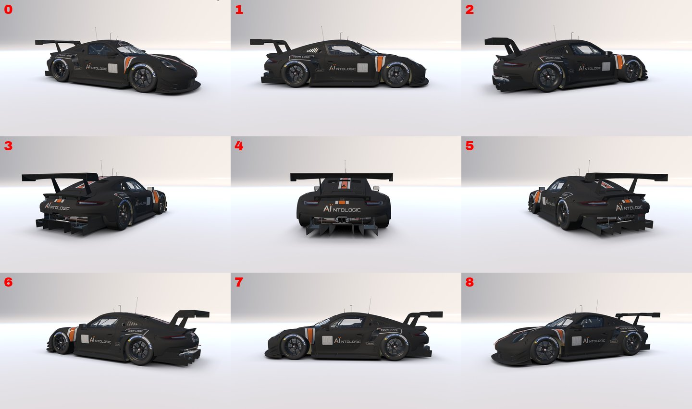
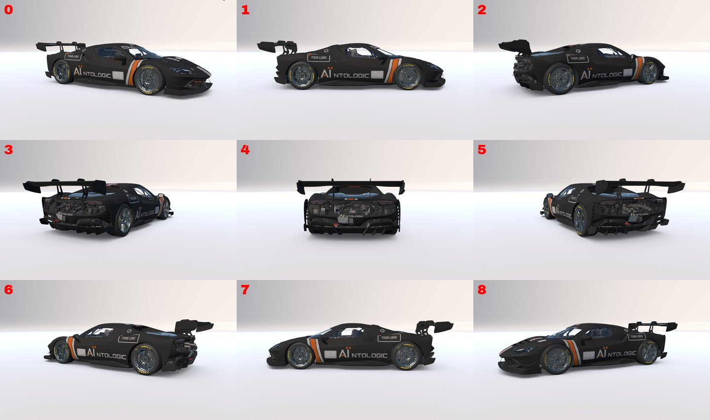
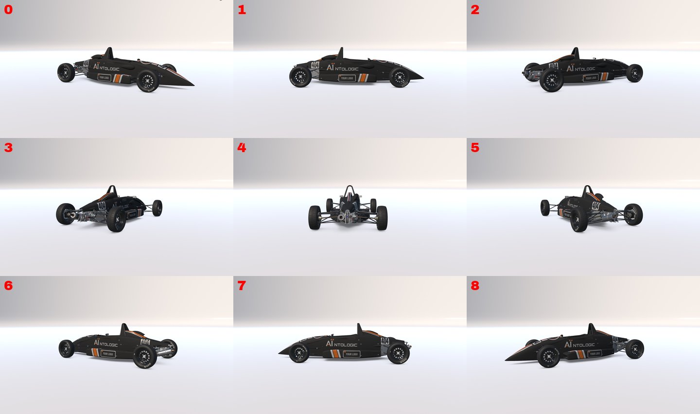
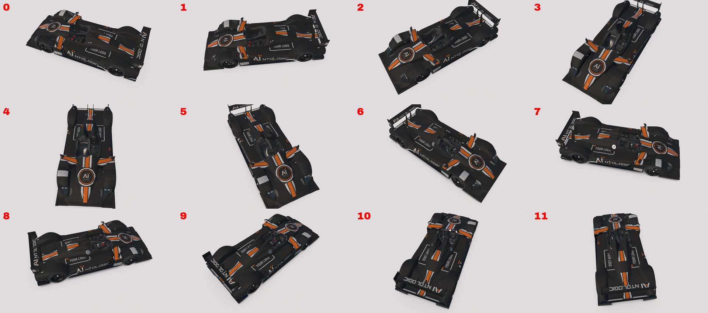

# Gallery — in-sim previews

Multi-angle previews of each **ready-made paint** as it renders in iRacing's car
viewer. Each is the neutral default — a blank driver strip and the "YOUR LOGO"
placeholder in both logo slots — so it shows exactly what you get before you add
your own ID, name and logos.

✅ = on-track verified.

| car | preview |
|---|---|
| Global Mazda MX-5 Cup ✅ |  |
| FIA F4 ✅ |  |
| SCCA Spec Racer Ford ✅ |  |
| Aston Martin Vantage GT3 EVO ✅ |  |
| Porsche 911 RSR |  |
| Ferrari 296 Challenge |  |
| Ray FF1600 |  |
| HPD ARX-01c |  |

The Lotus 79 and Skip Barber Formula 2000 previews are pending (their ready-made
paints still ship in `paints/`).
